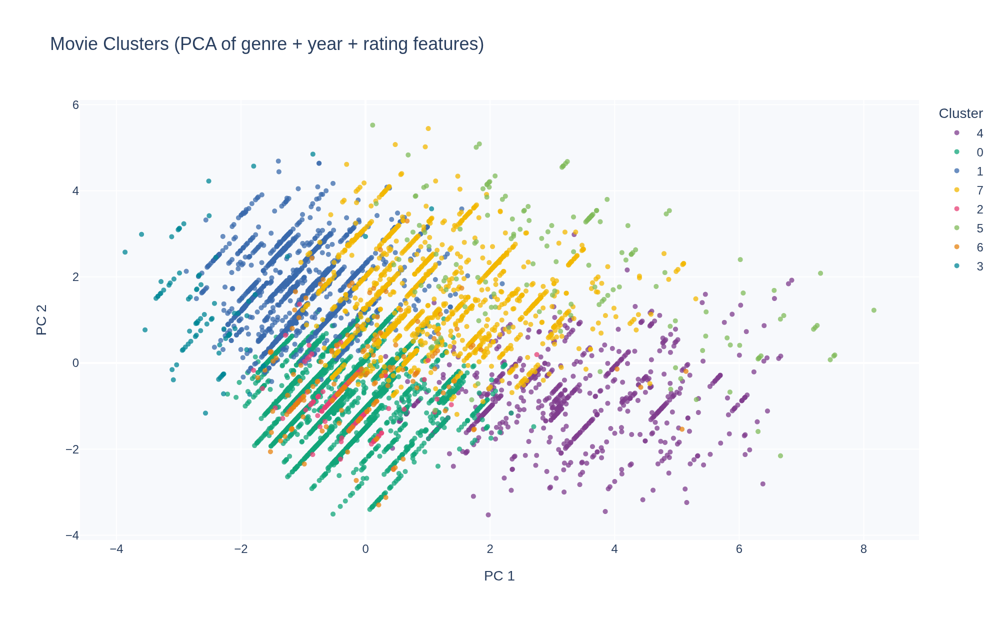
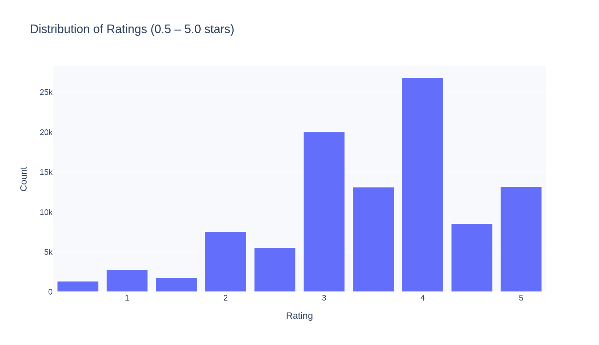
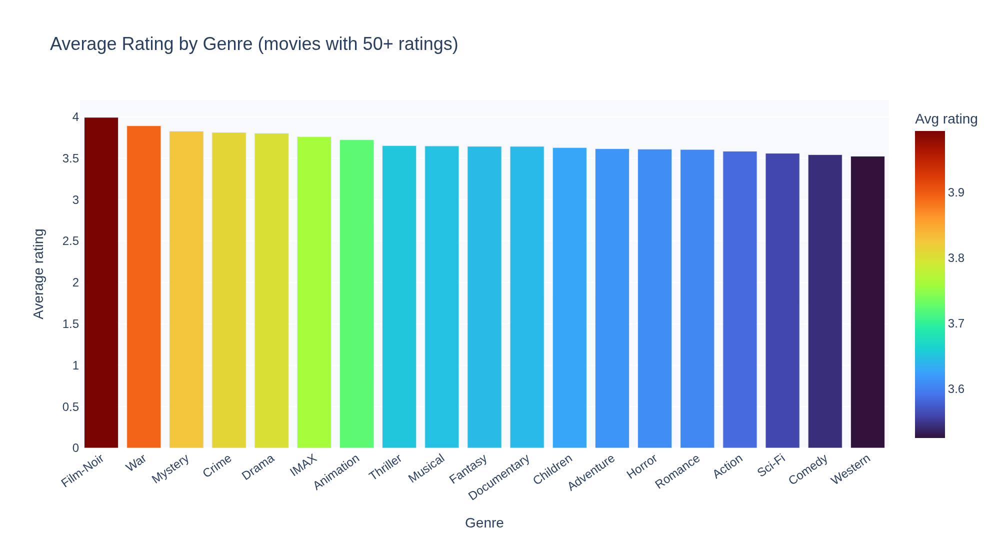
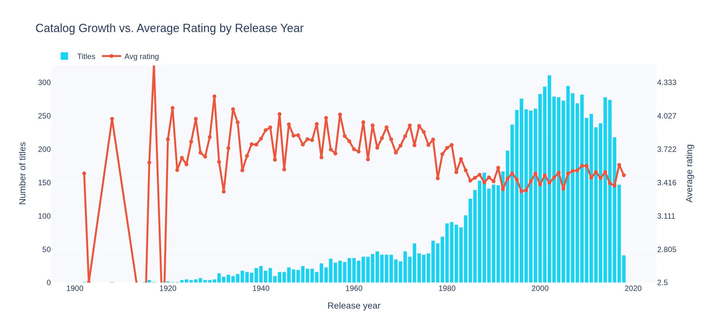
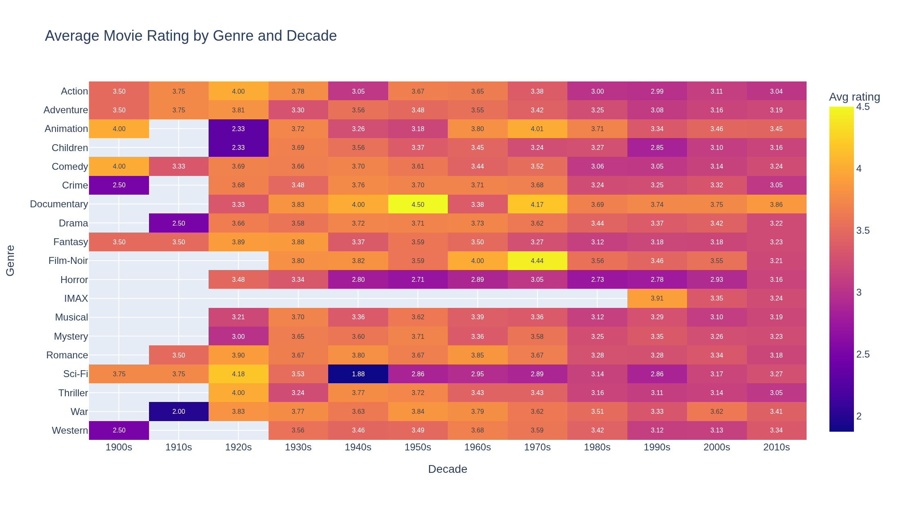
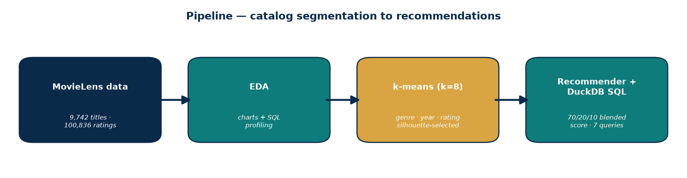

# Streaming Content Analytics


**MovieLens ml-latest-small** — 9,742 titles, 100,836 ratings from 610 users, 1996–2018. Public and free for non-commercial research, provided by [GroupLens Research](https://grouplens.org/datasets/movielens/) at the University of Minnesota. Drop `movies.csv` and `ratings.csv` into `data/` and everything runs offline from there. Details in `data/README_data.md`.

> F. Maxwell Harper and Joseph A. Konstan. 2015. *The MovieLens Datasets: History and Context.* ACM TiiS 5, 4: 19:1–19:19. https://doi.org/10.1145/2827872

## The business questions

Two questions every streaming service asks constantly:

1. *"What is our catalog, really?"* — not the marketing version, the data version. Where is the quality, where is the engagement, where are the gaps?
2. *"How do we keep someone watching after the credits roll?"* — recommendations that feel right, not random.

This project answers both: catalog segmentation through clustering, a content-based recommender, and analytical SQL over the whole thing.

## How to run it

```bash
pip install -r requirements.txt

# Full pipeline: EDA charts -> clustering -> recommender demo
python src/run_all.py

# Analytical SQL (DuckDB over the CSVs)
python sql/run_sql.py

# Or walk through it interactively
jupyter notebook notebooks/analysis.ipynb
```

> One environment note: the static PNG charts are exported with kaleido, which needs Google Chrome installed. If Chrome isn't there, the pipeline skips the PNGs with a warning and keeps going — the interactive HTML charts always work.

## What the numbers say

**Catalog segmentation (k-means, k=8 — chosen by silhouette score, not guessed):**

- The bulk of the catalog is **5,281 mainstream drama/comedy/romance titles** averaging 3.3★ — the "comfortable middle" of the library.
- **Small but mighty:** 429 pure documentaries rate **highest of any cluster (3.78★)** — a quality story hiding in a small corner. Under-merchandised, probably.
- **The engagement engine is kids' & family:** 695 titles averaging **13.0 ratings per title**, the most of any cluster — plus 158 IMAX event titles at 26.2 per title. Families show up and they rate.
- **Volume ≠ love:** the 1,210-title sci-fi/action cluster rates **lowest (3.09★)**. Big shelf space, lukewarm reception — a curation caveat, not a buying signal.
- A neat 85-title cluster of classic film-noir (avg year 1965, 3.67★) fell out on its own — the model never saw a plot summary.

### All 8 clusters at a glance

| # | Titles | Dominant genres | Avg rating | Avg year | Ratings/title |
| --- | ---: | --- | ---: | ---: | ---: |
| 0 | 5,281 | Drama, Comedy, Romance | 3.30 | 1993 | 8.2 |
| 1 | 1,689 | Thriller, Drama, Crime | 3.15 | 1997 | 11.6 |
| 2 | 429 | Documentary | 3.78 | 2002 | 2.8 |
| 3 | 85 | Film-Noir | 3.67 | 1965 | 10.2 |
| 4 | 695 | Children, Comedy, Animation | 3.15 | 1994 | 13.0 |
| 5 | 158 | IMAX | 3.31 | 2009 | 26.2 |
| 6 | 164 | Western | 3.39 | 1980 | 11.7 |
| 7 | 1,210 | Sci-Fi, Action, Adventure | 3.09 | 1995 | 17.1 |



**Recommendations that actually discriminate:**

- *The Matrix (1999)* → eXistenZ (0.993), Ready Player One (0.985), Equilibrium (0.947)
- *Toy Story (1995)* → Toy Story 2 (0.942), Antz (0.939), Monsters, Inc. (0.924)
- *Pulp Fiction (1994)* → Fargo (0.965), Fresh (0.931)

### Sample recommendations

| You watched | Top recommendation | Score |
| --- | --- | ---: |
| The Matrix (1999) | eXistenZ (1999) | 0.993 |
| The Matrix (1999) | Ready Player One | 0.985 |
| Toy Story (1995) | Toy Story 2 (1999) | 0.942 |
| Toy Story (1995) | Antz (1998) | 0.939 |
| Pulp Fiction (1994) | Fargo (1996) | 0.965 |
| Pulp Fiction (1994) | Fresh (1994) | 0.931 |

Full sample output in `outputs/recommendations.md`. Try it yourself: `recommend("The Matrix (1999)", n=5)`.

**SQL findings worth knowing:**

- **Your heaviest raters are your harshest critics.** Users averaging 472 ratings each score 3.54 on average, vs 3.67 for users averaging 26 ratings. If you ever weight ratings by user, calibrate for that.
- **Genre leaderboard needs a small-n warning:** Film-Noir ranks #1 by average rating (3.994) — across 4 movies. War is #2 (3.892, 19 movies). The ranking is real; the sample behind #1 is thin.
- Ratings skew happy overall (piling around 3.5–4.0★), and the catalog is heavily tilted toward recent decades while average ratings stay flat over time.





The genre-by-decade heatmap is one of my favorites — you can watch tastes shift over the years:



## Why I built it this way



- **k-means on genre + year + rating.** Genres are the natural segmentation axis for catalog strategy; release year and average rating are standardized so the one-hot genres don't drown out the signal.
- **k from silhouette scores (k=3..10), skipping k=2 on purpose** — k=2 always "wins" by splitting the catalog into two giant blobs, which tells you nothing. A choice, not a default.
- **Recommender blends genre TF-IDF cosine (70%) + year proximity (20%) + rating proximity (10%).** Pure genre similarity ties constantly — every same-genre movie scores exactly 1.0 — so the blend is what makes rankings actually discriminate. I verified the degenerate version first, then fixed it.

```python
year_prox = 1.0 / (1.0 + np.abs(years - own_year) / 10.0)
rating_prox = 1.0 - np.abs(avg_r - avg_r[idx]) / 4.5
sims = 0.7 * genre_sims + 0.2 * year_prox + 0.1 * rating_prox
# Sort by similarity desc, then popularity desc; exclude the movie itself.
order = np.lexsort((-movies["n_ratings"].to_numpy(), -sims))
```
- **DuckDB for the SQL layer.** Seven real analytical queries (CTEs, `ROW_NUMBER`, `NTILE`, `LAG`, rolling averages) running directly on the CSVs — no database to set up, the same SQL you'd run in a warehouse. Results in `outputs/sql_results.md`.

## Honest limitations

- **MovieLens is 1996–2018 and skewed toward engaged raters** — not casual viewers, not a current catalog. Findings describe this dataset, not streaming audiences in general.
- **Ratings only.** No watch time, no clicks, no completion rates — the signals a real service would actually optimize on.
- **Content-based only.** No collaborative filtering, and a brand-new title with no ratings is a cold start this system can't handle.
- **Clusters are descriptive, not ground truth.** k=8 is a judgment call backed by silhouette scores, not a discovered law of movies.

## What's inside

- `src/` — `eda.py`, `clustering.py`, `recommender.py`, `run_all.py` (one-command pipeline), `utils.py`
- `notebooks/analysis.ipynb` — the guided-tour version, fully runnable
- `sql/` — 7 analytical queries + DuckDB runner
- `outputs/` — charts (PNG + interactive HTML), `cluster_profiles.csv`, `recommendations.md`, `sql_results.md`

## What this demonstrates

- Framing catalog strategy and recommendations as business questions, then answering with data
- k-means clustering with silhouette-based model selection, TF-IDF feature engineering, cosine-similarity recommenders that actually discriminate
- Analytical SQL — CTEs, window functions, aggregation patterns — via DuckDB with zero setup
- Reproducible one-command pipelines with pinned dependencies and committed outputs
- Reading results like a stakeholder: segments to merchandise, caveats to respect

---

Built by Akanksha Sharma · MIT License
